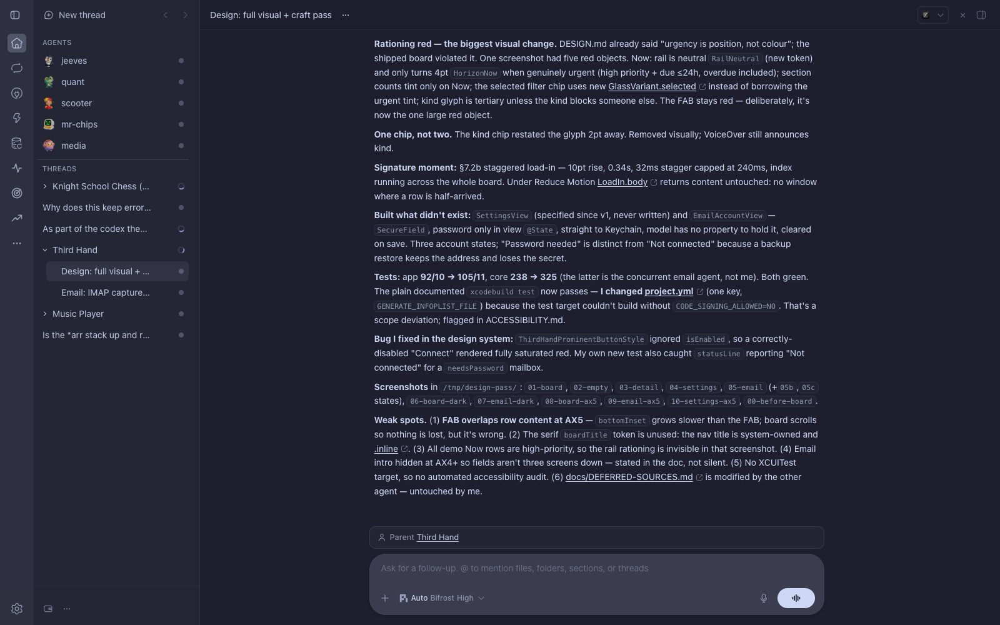

# Codex Theme for bb

A bb palette bringing visual and layout parity with the OpenAI Codex / ChatGPT desktop app.



## Features

- **Codex / ChatGPT Typography**: Uses the macOS system font (`SF Pro`) matching the desktop app, with tuned `430` text weight and a 14px type scale.
- **Codex Left Rail**: Glyphs at 20px (25px on touch) inside 34px controls (larger hover pills) with a tight 4px row gap, in a 52px rail.
- **Codex Send Indicator Arrow**: Replaces the return icon (`CornerDownLeft`) with the upward send arrow from Codex (`arrow-up-lg-light-20`).
- **Codex Composer Geometry**:
  - `26px` rounded container corners (matching Codex's `calc(var(--spacing) * 7)` radius).
  - Compact box height with symmetric padding, so text and action buttons share one centerline.
  - Circular `32px` send button (`rounded-full`).
- **Color Parity**:
  - Composer uses the theme's `--popover` / `--popover-border` tokens: `#3b3c4f` / `#404153` (sampled from Codex) in dark mode, light surface in light mode.
  - Text tiers derived from `--ink` with Codex's contrast curve, so `muted`/`subtle`/`sidebar` read the way Codex renders them.
  - Preserves native theme contrast, focus states, and disabled button behavior.
- **Codex Context Menus & Dropdowns**:
  - `16px` rounded container corners (matching Codex's `--menu-radius: var(--radius-2xl)`).
  - Concentric `10px` rounded menu items with tuned padding, hover states, and preserved destructive actions.
  - `#3b3c4f` elevated surface background and `#404153` border.
- **Codex Notification Popups**:
  - `16px` rounded toast containers matching Codex alert geometry.
  - `#3b3c4f` elevated background, `#404153` border, and rich elevation shadow.
  - On phones the toast layer is sized to its cards and ignores taps, so a notification never blocks typing, scrolling, or the composer behind it.
  - Semantic icon accents, clean typography, and pill action buttons.
- **Decluttered View**: Removes the top-right collapse chevron and bottom composer footer for a minimal, focused prompt area.
- **Catppuccin Palette**: Retains full Catppuccin syntax highlighting and terminal ANSI colors.
- **Contained wide tables**: Tables stay in the message column, scroll sideways, and fade at the right edge until the last column.
- **Quieter menus**: Menus fade in and settle by 2px instead of zooming, and skip the animation with reduced motion.

## Two palettes

The plugin adds two themes to Settings → Appearance:

| Theme | Colors | Code highlighting |
| --- | --- | --- |
| **Codex** (`plugin:codex-theme:codex`) | Catppuccin Latte / Mocha with Codex's text tiers | Catppuccin |
| **Codex (BB colors)** (`plugin:codex-theme:codex-bb`) | BB's default light and dark palette | Pierre |

Both share the same typography, layout, and settings below.

## Optional changes

Turn these on in Settings → Plugins → Codex Theme, or with
`bb plugin config codex-theme set <key> true`. All are off by default, and they apply
live to whichever Codex theme is active.

| Setting | Key | What it does |
| --- | --- | --- |
| Centered welcome on new threads | `welcome` | A BB logo and "What should we build in *project*?" with the composer near the bottom. Wide windows only. |
| Show the bar under the composer | `composerFooter` | Keeps the environment chip and context ring, without "New thread in this environment". |
| Filled icon for the selected rail item | `filledNavIcons` | High-contrast, filled glyph for the current page in the rail. |
| Thread outline on the left | `outlineOnLeft` | Moves the thread outline to the left, opening toward the messages. |
| Instant sidebar | `instantSidebar` | No animation when the sidebar or its sections open and close. |
| Hide empty sidebar sections | `hideEmptySections` | Hides expanded sidebar sections with no threads, as Codex does. Collapsed sections keep their header. |
| Codex thread status | `threadStatus` | A blue dot for unread finished threads and a ring spinner for working ones. |

The BB colors palette, the optional changes, the table and menu refinements come from
[Jaryd Diamond](https://github.com/jarydo)'s bb-codex fork, folded back in as options.

## Installation

### As a plugin (recommended)

Install from the marketplace, or straight from this repository:

```bash
bb plugin install git:https://github.com/steveafrost/bb-theme-codex.git --yes
```

Installing activates the palette on its own: the plugin's `onInstall` hook runs
once after a fresh install and selects it. If you were already on a non-default
palette the hook leaves your choice alone, and `bb theme set
plugin:codex-theme:codex` (or `plugin:codex-theme:codex-bb` for BB colors) switches
whenever you want.

The plugin registers the palette as **Codex** and survives bb upgrades, because bb
rebuilds it from source on install. Update with `bb plugin update codex-theme`.

### As a custom theme directory

Clone into your custom themes directory and activate it. The folder name is the
displayed theme name:

```bash
git clone https://github.com/steveafrost/bb-theme-codex.git ~/.bb/theme/Codex
bb theme set Codex
```

Either way the theme takes effect immediately in running windows without a restart.
The custom theme directory gets only the Catppuccin theme, without the optional
changes: those need the plugin's settings and app entry.

Pick one. If the plugin is installed, use the plugin alone — a clone of this repo
sitting in the custom themes directory is a second copy of the same `theme.css`
that drifts the moment one is updated without the other.

## Updating

```bash
bb plugin update codex-theme     # plugin install
git -C ~/.bb/theme/Codex pull    # custom theme directory
```

### Stuck on 0.1.x?

If you installed from the marketplace before v0.2.0, `bb plugin update` will keep
reporting you are current even though newer releases exist. That install recorded
a `^0.1.0` range, and bb resolves updates against the range stored at install
time rather than the range the marketplace advertises today, so nothing from the
0.2 line is visible to it. `bb` also refuses to change an installed plugin's
source in place, so re-installing over the top fails with *"already installed
from…"*.

Remove and install again to move to the 0.2 line:

```bash
bb plugin config codex-theme --json   # note your settings first
bb plugin remove codex-theme
bb plugin install codex-theme --yes
```

**Removal deletes the plugin's settings**, so re-enable the optional changes you
had on once it is back. The new install records a `>=0.1.0 <1.0.0` range and
updates normally from then on.

Installs made with the plain `git:` command above are unaffected — that records
the default branch, not a range, and has always tracked `main`.

## Reset / Uninstall

```bash
bb plugin remove codex-theme     # plugin install
bb theme reset                   # back to the default theme
```

## Layout

| Path | Purpose |
| --- | --- |
| `theme.css` | The Codex theme: palette, layout, and the optional blocks. The source for both themes. |
| `palettes/bb.css` | BB colors replacements for each `/* @region */` block in `theme.css`. |
| `theme-bb.css` | Generated **Codex (BB colors)** theme. Do not edit; run `npm run build:themes`. |
| `options.ts` | The optional changes: setting keys, labels, and the `data-codex-*` attribute each one sets on `<html>`. |
| `server.ts` | Declares the settings. |
| `app.tsx` / `app.css` | Mirrors the settings onto `<html>` (cached so they apply at startup) and renders the new-thread welcome. |
| `bb-logo.ts` | BB's logo for the welcome. |
| `theme.json` | Code-theme pairing for the custom-theme-directory install (Catppuccin Mocha / Latte). |
| `package.json` | Plugin manifest: both `bb.themes`, `bb.server`, and `bb.app`. |
| `assets/icon.svg` | Plugin icon shown in bb's plugin list and the marketplace. |
| `preview.png` | Preview screenshot used by this README and the marketplace listing. |

Custom theme CSS is injected unlayered, so it beats bb's `@layer base` defaults and
no bb source change is ever needed. An optional change is a block in `theme.css`
whose selectors all start with `:root[data-codex-<name>]`, plus an entry in
`options.ts`.

## Development

```bash
npm install
npm run build:themes   # regenerate theme-bb.css after editing theme.css or palettes/bb.css
npm run typecheck
npm test               # includes a check that theme-bb.css is up to date
bb plugin build
bb plugin reload codex-theme
```
