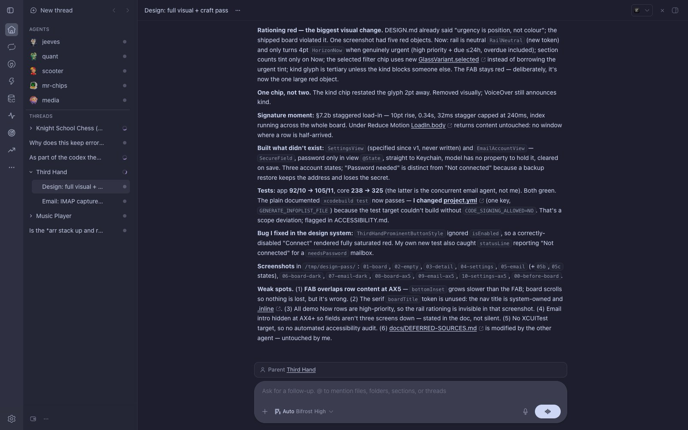

# Codex Theme for bb

A bb palette bringing visual and layout parity with the OpenAI Codex / ChatGPT desktop app.



## Features

- **Codex / ChatGPT Typography**: Uses the macOS system font (`SF Pro`) matching the desktop app, with tuned `430` text weight and a 14px type scale.
- **Codex Left Rail**: Glyphs at 20px (25px on touch) inside 34px controls (larger hover pills) with a tight 4px row gap, in a 52px rail.
- **Codex Send Indicator Arrow**: Replaces the return icon (`CornerDownLeft`) with the upward send arrow from Codex (`arrow-up-lg-light-20`).
- **Codex Composer Geometry**:
  - `26px` rounded container corners (matching Codex's `calc(var(--spacing) * 7)` radius).
  - Compact box height with symmetric padding, so text and action buttons share one centerline.
  - Circular `32px` send button (`rounded-full`).
- **Color Parity**:
  - Composer uses the theme's `--popover` / `--popover-border` tokens: `#3b3c4f` / `#404153` (sampled from Codex) in dark mode, light surface in light mode.
  - Text tiers derived from `--ink` with Codex's contrast curve, so `muted`/`subtle`/`sidebar` read the way Codex renders them.
  - Preserves native theme contrast, focus states, and disabled button behavior.
- **Codex Context Menus & Dropdowns**:
  - `16px` rounded container corners (matching Codex's `--menu-radius: var(--radius-2xl)`).
  - Concentric `10px` rounded menu items with tuned padding, hover states, and preserved destructive actions.
  - `#3b3c4f` elevated surface background and `#404153` border.
- **Codex Notification Popups**:
  - `16px` rounded toast containers matching Codex alert geometry.
  - `#3b3c4f` elevated background, `#404153` border, and rich elevation shadow.
  - Semantic icon accents, clean typography, and pill action buttons.
- **Decluttered View**: Removes the top-right collapse chevron and bottom composer footer for a minimal, focused prompt area.
- **Catppuccin Palette**: Retains full Catppuccin syntax highlighting and terminal ANSI colors.

## Installation

### As a plugin (recommended)

Install from the marketplace, or straight from this repository:

```bash
bb plugin install git:https://github.com/steveafrost/bb-theme-codex.git --yes
bb theme set plugin:codex-theme:codex
```

The plugin registers the palette as **Codex** and survives bb upgrades, because bb
rebuilds it from source on install. Update with `bb plugin update codex-theme`.

### As a custom theme directory

Clone into your custom themes directory and activate it. The folder name is the
displayed theme name:

```bash
git clone https://github.com/steveafrost/bb-theme-codex.git ~/.bb/theme/Codex
bb theme set Codex
```

Either way the theme takes effect immediately in running windows without a restart.

Pick one. If the plugin is installed, use the plugin alone — a clone of this repo
sitting in the custom themes directory is a second copy of the same `theme.css`
that drifts the moment one is updated without the other.

## Updating

```bash
bb plugin update codex-theme     # plugin install
git -C ~/.bb/theme/Codex pull    # custom theme directory
```

## Reset / Uninstall

```bash
bb plugin remove codex-theme     # plugin install
bb theme reset                   # back to the default theme
```

## Layout

| Path | Purpose |
| --- | --- |
| `theme.css` | The entire palette and layout override. Served to bb both as a custom theme and through `bb.themes`. |
| `theme.json` | Code-theme pairing for the custom-theme-directory install (Catppuccin Mocha / Latte). |
| `package.json` | Plugin manifest: `bb.themes` points at `./theme.css`, `bb.server` at `server.ts`. |
| `server.ts` | Required backend entry. Contributes nothing at runtime; the palette is declarative. |
| `assets/icon.svg` | Plugin icon shown in bb's plugin list and the marketplace. |
| `preview.png` | Preview screenshot used by this README and the marketplace listing. |

Editing `theme.css` is the whole job — both install paths read that one file.
Custom theme CSS is injected unlayered, so it beats bb's `@layer base` defaults and
no bb source change is ever needed.

After editing, rebuild and reload:

```bash
bb plugin build
bb plugin reload codex-theme
```
